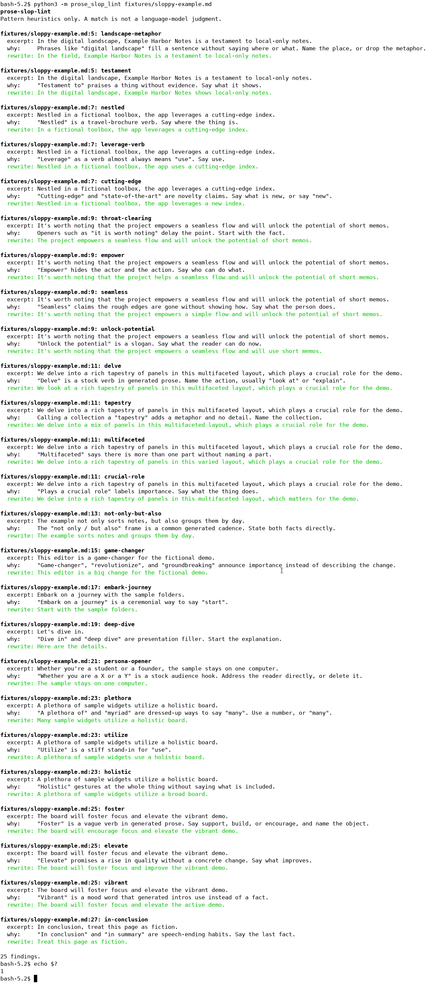

[English](README.md) | [简体中文](README.zh-CN.md) | [繁體中文](README.zh-TW.md) | [日本語](README.ja.md)

# prose-slop-lint

prose-slop-lint は、README、ドキュメント、pull request の説明文を読むためのオフラインのコマンドラインツールです。英語でありがちな、中身の薄い AI 調の言い回しを探し、自分で直せるより平易な書き換え案を出します。

一致は正規表現のヒューリスティックです。言語モデルの判定ではありません。文章がモデルの出力かどうかは決めません。盗作の検出もしません。テキストは送信しません。API キーは読まず、ネットワークにも接続しません。実行に必要なのは Python 3 の標準ライブラリだけで、追加の pip パッケージは要りません。

コマンドの出力は英語です。同じ説明は [English](README.md)、[简体中文](README.zh-CN.md)、[繁體中文](README.zh-TW.md) にもあります。

## 実行する

クローンしたあと、必要なコマンドは二つです。クローン自体を数えても三つのコマンドで、インストール作業はありません。

```bash
git clone https://github.com/xuqijx/prose-slop-lint.git
cd prose-slop-lint
python3 -m prose_slop_lint fixtures/sloppy-example.md
```

複数のファイル、ディレクトリ、パイプからのテキストも渡せます。

```bash
python3 -m prose_slop_lint README.md docs/
python3 -m prose_slop_lint --json fixtures/sloppy-example.md
cat notes.txt | python3 -m prose_slop_lint
```

ディレクトリを渡すと `.md`、`.markdown`、`.txt`、`.rst`、`.adoc`、`.asciidoc` を見ます。それ以外の種類でも、ファイル名を指定すれば対象になります。インラインコードとフェンスされたコードブロックは飛ばすので、ドキュメントはバッククォートで該当の語句を引用できます。

終了コード:

| コード | 意味 |
| --- | --- |
| 0 | 指摘なし |
| 1 | 指摘が 1 件以上 |
| 2 | 使い方の問題。例: パスが存在しない |

## 指摘に含まれるもの

各指摘には、ルール id、ファイル、行、抜粋、一致した理由、より平易な書き換え案が含まれます。

書き換えは機械的な置換です。貼り付ける前に読んでください。文としては、まだ人が直す必要がある場合があります。

## デモ

下の画像は実際のターミナルセッションを撮ったもので、出力を描いた図ではありません。シェルは `python3 -m prose_slop_lint fixtures/sloppy-example.md` を実行し、続けて `echo $?` を実行しました。表示された終了ステータスは `1` です。文字の周りの余白は切り取ってあります。画像の文字はそのセッションの出力です。



## サンプル

`fixtures/sloppy-example.md` と `fixtures/cleaner-example.md` はフィクションの例です。実在の製品、会社、人物を説明していません。拙い方はヒューリスティックに引っかかるように書いてあります。平易な方は普通の説明で、指摘はより少ないか、通常はゼロです。

フェンス内の引用は走査しません。次は説明のための例です。

```text
In the digital landscape, we delve into a rich tapestry.
```

## ルール

検査は粗いものです。実際の技術文書でも一致することがあります。その語句が意図どおりなら、文を残してください。

ルールが探すのは英語の語句だけです。他の言語の文章は採点しません。

| ルール id | 見直す点 |
| --- | --- |
| `delve` | 定番の動詞。もっと直接的な動詞にする。 |
| `tapestry` | 中身のない、集まりへの比喩。 |
| `landscape-metaphor` | 場所を言わずに景色の言葉で埋める言い方。 |
| `leverage-verb` | use で足りる、硬い動詞。 |
| `seamless` | 仕組みを書かない「スムーズです」という主張。 |
| `unlock-potential` | まだ使っていない能力についてのスローガン。 |
| `game-changer` | 変化を説明せず、重要だと宣言する言い方。 |
| `throat-clearing` | 事実の前に置く前置き。 |
| `not-only-but-also` | 二つの事実を直接書けば足りる、対の定型。 |
| `testament` | 根拠のない賞賛。 |
| `embark-journey` | 「始める」を儀式ばった言い方にしたもの。 |
| `nestled` | 場所をパンフレットのように書く動詞。 |
| `empower` | 誰が何をできるのかが書かれていない。 |
| `cutting-edge` | 新しさの主張。 |
| `deep-dive` | 説明の前に置く口上。 |
| `multifaceted` | 「部分が多い」と言うだけで、部分を挙げない。 |
| `plethora` | many を大げさにした言い方。 |
| `utilize` | use の硬い言い換え。 |
| `holistic` | 中身を書かずに全体へ手を振る言い方。 |
| `crucial-role` | 仕事の内容ではなく、重要性のラベル。 |
| `persona-opener` | 二種類の読者を名指しする定型の書き出し。 |
| `in-conclusion` | 最後の事実の前に置く、話の締めくくり。 |
| `foster` | あいまいな「促す」系の動詞。 |
| `elevate` | 具体的な変化がない、質が上がるという主張。 |
| `vibrant` | 事実の代わりに置く気分の言葉。 |

## チェック

```bash
python3 check.py
```

`check.py` は標準ライブラリの `unittest` を使います。フィクションの拙いサンプルでルールが反応すること、平易なサンプルでは静かなこと、終了コードが上の表どおりであること、この四つの README があることを確認します。

### 実際に実行したもの

2026-11-08、Linux 上の Python 3.12.3 で実行しました。

| コマンド | 終了コード |
| --- | --- |
| `python3 check.py` | 0 |
| `python3 -m prose_slop_lint fixtures/sloppy-example.md` | 1 |
| `python3 -m prose_slop_lint fixtures/cleaner-example.md` | 0 |
| `python3 -m prose_slop_lint fixtures/missing-example.md` | 2 |

`docs/demo.png` は同じ環境で、拙いサンプルのコマンドを実行したターミナルから取り込みました。

### テストしていないこと

- Windows、macOS、Python 3.12.3 以外の版
- インストールやパッケージ化。入れるべきパッケージはありません
- エディタのプラグイン、git hook、ホストされた CI
- 実際のプロジェクト文書で一致がどれだけ役立つか。二つのフィクスチャは小さなフィクションの例です
- 英語以外の本文。ルールはそれらの言語を見ていません

## ライセンス

[MIT](LICENSE)。
