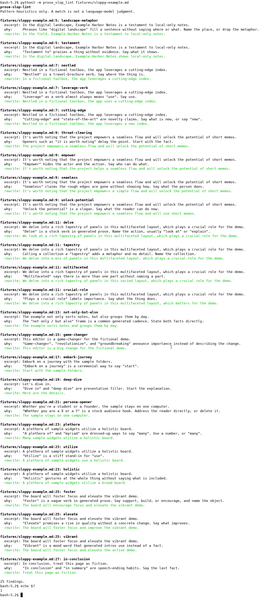

[English](README.md) | [简体中文](README.zh-CN.md) | [繁體中文](README.zh-TW.md) | [日本語](README.ja.md)

# prose-slop-lint

prose-slop-lint is an offline command-line tool for people who write READMEs, docs, and pull-request text. It scans that prose for padded, AI-flavored English phrasing and prints a report with a plainer rewrite you can edit by hand.

A match is a regular-expression heuristic. It is not a judgment from a language model. The tool does not decide that a model wrote the text, and it does not detect plagiarism. Nothing is uploaded. There is no API key and no network connection. Running it needs Python 3 and the standard library only.

Command output is English. The same instructions are in [简体中文](README.zh-CN.md), [繁體中文](README.zh-TW.md), and [日本語](README.ja.md).

## Run it

After cloning, two commands are enough. Counting the clone, a newcomer needs three commands and no install:

```bash
git clone https://github.com/xuqijx/prose-slop-lint.git
cd prose-slop-lint
python3 -m prose_slop_lint fixtures/sloppy-example.md
```

You can also pass several files, a directory, or piped text:

```bash
python3 -m prose_slop_lint README.md docs/
python3 -m prose_slop_lint --json fixtures/sloppy-example.md
cat notes.txt | python3 -m prose_slop_lint
```

A directory scan includes `.md`, `.markdown`, `.txt`, `.rst`, `.adoc`, and `.asciidoc`. Named files of other types are scanned too. Inline code and fenced code blocks are skipped, so a doc can quote a flagged phrase.

Exit status:

| Status | Meaning |
| --- | --- |
| 0 | No findings |
| 1 | At least one finding |
| 2 | Usage problem, such as a missing path |

## What a finding contains

Each finding reports the rule id, file, line, excerpt, why it matched, and a suggested plainer rewrite.

The rewrite is a mechanical substitution. Read it before you paste it. The sentence may still need a human edit.

## Demo

This image is a capture of a real terminal session, not a drawing of the output. The shell ran `python3 -m prose_slop_lint fixtures/sloppy-example.md`, then `echo $?`. The shell printed `1`. Empty margin around the text was trimmed. The words in the image are the session output.



## Samples

`fixtures/sloppy-example.md` and `fixtures/cleaner-example.md` are fictional examples. They do not describe a real product, company, or person. The noisy file is written to trip the heuristics. The plain file is ordinary description and should report fewer findings, usually none.

A fenced quote is ignored. This one is only an illustration:

```text
In the digital landscape, we delve into a rich tapestry.
```

## Rules

The checks are blunt. A real technical doc can match them. Keep the sentence when the phrase is the one you meant.

The rules look for English phrases only. They do not score writing in other languages.

| Rule id | What it asks you to reconsider |
| --- | --- |
| `delve` | A stock verb. Prefer a direct one. |
| `tapestry` | A collection metaphor with no detail. |
| `landscape-metaphor` | A scenery phrase used as a place filler. |
| `leverage-verb` | A stiff verb where "use" is enough. |
| `seamless` | A smoothness claim with no mechanism. |
| `unlock-potential` | A slogan about unused capability. |
| `game-changer` | Importance announced instead of described. |
| `throat-clearing` | An opener that delays the fact. |
| `not-only-but-also` | A two-part cadence that can be two plain facts. |
| `testament` | Praise with no evidence. |
| `embark-journey` | A ceremonial way to say start. |
| `nestled` | A brochure verb for a location. |
| `empower` | The actor and the action are left unnamed. |
| `cutting-edge` | A novelty claim. |
| `deep-dive` | Presentation filler before the explanation. |
| `multifaceted` | "Many parts," with no part named. |
| `plethora` | A dressed-up "many." |
| `utilize` | A stiff stand-in for "use." |
| `holistic` | A gesture at the whole, with no contents. |
| `crucial-role` | An importance label instead of a job. |
| `persona-opener` | A stock hook that names two kinds of reader. |
| `in-conclusion` | A speech ending placed before the last fact. |
| `foster` | A vague support verb. |
| `elevate` | A quality claim with no concrete change. |
| `vibrant` | A mood word standing in for a fact. |

## Checks

```bash
python3 check.py
```

`check.py` uses `unittest` from the standard library. It checks that the rules fire on the noisy fictional sample, that the plain sample stays quiet, that the exit codes behave as described above, and that these four README files exist.

### What was tested

On 2026-11-08, with Python 3.12.3 on Linux:

| Command | Exit code |
| --- | --- |
| `python3 check.py` | 0 |
| `python3 -m prose_slop_lint fixtures/sloppy-example.md` | 1 |
| `python3 -m prose_slop_lint fixtures/cleaner-example.md` | 0 |
| `python3 -m prose_slop_lint fixtures/missing-example.md` | 2 |

`docs/demo.png` was captured in that same environment from a terminal that ran the noisy-sample command.

### What was not tested

- Windows, macOS, and Python versions other than 3.12.3
- Installing or packaging the tool. There is no package to install
- Editor plugins, git hooks, and hosted CI
- How often a match is useful on real project docs. The fixtures are small fictional samples
- Prose written in languages other than English

## License

[MIT](LICENSE).
