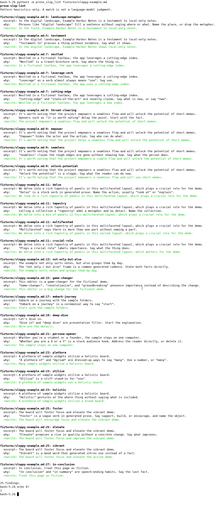

[English](README.md) | [简体中文](README.zh-CN.md) | [繁體中文](README.zh-TW.md) | [日本語](README.ja.md)

# prose-slop-lint

prose-slop-lint 是一个离线命令行工具，用来检查 README、文档和 pull request 说明里的英文。它查找常见的、空泛的、带 AI 腔的说法，并给出一段更直白的改写，供你自己修改。

命中来自正则启发式规则，不是语言模型的判断。这个工具不判断文章是不是模型写的，也不做抄袭检测。文本不会上传。它不读取 API 密钥，也不建立网络连接。运行它只需要 Python 3 标准库，不必再装 pip 包。

命令行输出是英文。用法说明还有 [English](README.md)、[繁體中文](README.zh-TW.md) 和 [日本語](README.ja.md)。

## 运行

克隆之后，两条命令就能跑。连同克隆本身，一共三步，没有安装步骤：

```bash
git clone https://github.com/xuqijx/prose-slop-lint.git
cd prose-slop-lint
python3 -m prose_slop_lint fixtures/sloppy-example.md
```

也可以传入多个文件、一个目录，或从管道读入文本：

```bash
python3 -m prose_slop_lint README.md docs/
python3 -m prose_slop_lint --json fixtures/sloppy-example.md
cat notes.txt | python3 -m prose_slop_lint
```

扫描目录时会看 `.md`、`.markdown`、`.txt`、`.rst`、`.adoc` 和 `.asciidoc`。如果你点名了其他类型的文件，也会扫描。行内代码和围栏代码块会被跳过，因此文档可以用反引号引用会被标记的短语。

退出码：

| 状态 | 含义 |
| --- | --- |
| 0 | 没有发现 |
| 1 | 至少有一条发现 |
| 2 | 用法有问题，例如路径不存在 |

## 一条发现里有什么

每条发现都包含：规则 id、文件、行号、摘录、为什么命中，以及建议的更直白改写。

改写是机械替换。贴回去之前请先读一遍。句子可能还要人来改。

## 演示

下面这张图来自一次真实的终端会话，不是手绘的输出稿。会话里先执行 `python3 -m prose_slop_lint fixtures/sloppy-example.md`，再执行 `echo $?`，屏幕上印出 `1`。文字四周的空白边距裁掉了。图里的文字就是那次会话的输出。



## 样例

`fixtures/sloppy-example.md` 和 `fixtures/cleaner-example.md` 都是虚构示例。它们不描述真实的产品、公司或个人。拙劣样例是故意写得空洞，用来触发启发式规则。另一份是普通说明，发现应该更少，通常是零。

围栏里的引用不会被扫描。下面只是举例：

```text
In the digital landscape, we delve into a rich tapestry.
```

## 规则

这些检查很粗。真正的技术文档也可能被命中。如果那个说法就是你想用的，把句子留下即可。

规则只查找英文短语，不会给其他语言的文章打分。

| 规则 id | 它让你重新看什么 |
| --- | --- |
| `delve` | 一个很俗的动词。换成直接的动词。 |
| `tapestry` | 用来称呼一组东西的比喻，里面没有具体内容。 |
| `landscape-metaphor` | 用景物说法占位置，却没有说出地点。 |
| `leverage-verb` | 一个生硬的动词，写成 use 就够了。 |
| `seamless` | 声称很顺，却没有说明是怎么做到的。 |
| `unlock-potential` | 一句关于“还没发挥出来”的口号。 |
| `game-changer` | 只宣布很重要，没有描述变化。 |
| `throat-clearing` | 先清嗓子，把事实往后推。 |
| `not-only-but-also` | 两段式的套话，可以直接写成两件事实。 |
| `testament` | 只有称赞，没有证据。 |
| `embark-journey` | 用很隆重的说法表示“开始”。 |
| `nestled` | 像宣传册一样描写位置。 |
| `empower` | 没有写明谁可以做什么。 |
| `cutting-edge` | 一句“很新”的宣称。 |
| `deep-dive` | 正题开始前的口头填充。 |
| `multifaceted` | 只说“有很多部分”，却不说出任何一部分。 |
| `plethora` | 把 many 说得很夸张。 |
| `utilize` | use 的生硬替身。 |
| `holistic` | 只做个“看整体”的手势，没有内容。 |
| `crucial-role` | 只贴一个“很重要”的标签，没有写出职责。 |
| `persona-opener` | 开头点名两类读者的套话。 |
| `in-conclusion` | 把收尾口头语放在最后事实前面。 |
| `foster` | 含糊的“促进”类动词。 |
| `elevate` | 声称质量会上升，却没有具体变化。 |
| `vibrant` | 用情绪词代替事实。 |

## 检查

```bash
python3 check.py
```

`check.py` 使用标准库里的 `unittest`。它会确认：规则能在虚构的拙劣样例上命中，平实样例保持安静，退出码符合上面的约定，并且这四份 README 都存在。

### 实际跑过的内容

2026-11-08，在 Linux 上使用 Python 3.12.3：

| 命令 | 退出码 |
| --- | --- |
| `python3 check.py` | 0 |
| `python3 -m prose_slop_lint fixtures/sloppy-example.md` | 1 |
| `python3 -m prose_slop_lint fixtures/cleaner-example.md` | 0 |
| `python3 -m prose_slop_lint fixtures/missing-example.md` | 2 |

`docs/demo.png` 是在同一环境里，从执行拙劣样例命令的终端截取的。

### 没有测试的内容

- Windows、macOS，以及 3.12.3 以外的 Python 版本
- 安装或打包。这个仓库没有需要安装的包
- 编辑器插件、git 钩子和托管 CI
- 这些规则在真实项目文档里有多常派上用场。两份夹具都是很小的虚构样例
- 英文以外的正文。规则不覆盖那些语言

## 许可证

[MIT](LICENSE)。
