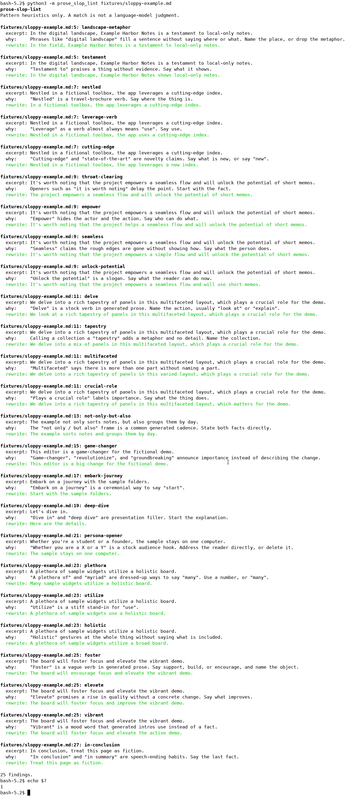

[English](README.md) | [简体中文](README.zh-CN.md) | [繁體中文](README.zh-TW.md) | [日本語](README.ja.md)

# prose-slop-lint

prose-slop-lint 是一個離線命令列工具，用來檢查 README、文件和 pull request 說明裡的英文。它找出常見、空泛、帶有 AI 腔的說法，並給出一段更直白的改寫，讓你自己修改。

命中來自正規表示式的啟發式規則，不是語言模型的判斷。這個工具不判斷文章是不是模型寫的，也不做抄襲偵測。文字不會上傳。它不讀取 API 金鑰，也不建立網路連線。執行它只需要 Python 3 標準程式庫，不必再裝 pip 套件。

命令列輸出是英文。用法說明還有 [English](README.md)、[简体中文](README.zh-CN.md) 和 [日本語](README.ja.md)。

## 執行

複製儲存庫之後，兩道命令就能跑。連同複製本身，一共三步，沒有安裝步驟：

```bash
git clone https://github.com/xuqijx/prose-slop-lint.git
cd prose-slop-lint
python3 -m prose_slop_lint fixtures/sloppy-example.md
```

也可以傳入多個檔案、一個目錄，或從管線讀入文字：

```bash
python3 -m prose_slop_lint README.md docs/
python3 -m prose_slop_lint --json fixtures/sloppy-example.md
cat notes.txt | python3 -m prose_slop_lint
```

掃描目錄時會看 `.md`、`.markdown`、`.txt`、`.rst`、`.adoc` 和 `.asciidoc`。若你點名了其他類型的檔案，也會掃描。行內程式碼和圍欄程式碼區塊會被略過，因此文件可以用反引號引用會被標記的片語。

結束狀態：

| 狀態 | 意義 |
| --- | --- |
| 0 | 沒有發現 |
| 1 | 至少有一則發現 |
| 2 | 用法有問題，例如路徑不存在 |

## 一則發現裡有什麼

每則發現都包含：規則 id、檔案、行號、摘錄、為什麼命中，以及建議的更直白改寫。

改寫是機械式替換。貼回去之前請先讀一遍。句子可能還要人來改。

## 示範

下面這張圖來自一次真實的終端機會話，不是手繪的輸出稿。會話裡先執行 `python3 -m prose_slop_lint fixtures/sloppy-example.md`，再執行 `echo $?`，螢幕上印出 `1`。文字四周的空白邊距裁掉了。圖裡的文字就是那次會話的輸出。



## 範例

`fixtures/sloppy-example.md` 和 `fixtures/cleaner-example.md` 都是虛構範例。它們不描述真實的產品、公司或個人。拙劣範例是故意寫得空洞，用來觸發啟發式規則。另一份是普通說明，發現應該更少，通常是零。

圍欄裡的引用不會被掃描。下面只是舉例：

```text
In the digital landscape, we delve into a rich tapestry.
```

## 規則

這些檢查很粗。真正的技術文件也可能被命中。如果那個說法就是你想用的，把句子留下即可。

規則只尋找英文片語，不會為其他語言的文章評分。

| 規則 id | 它讓你重新看什麼 |
| --- | --- |
| `delve` | 一個很俗的動詞。換成直接的動詞。 |
| `tapestry` | 用來稱呼一組東西的比喻，裡面沒有具體內容。 |
| `landscape-metaphor` | 用景物說法佔位置，卻沒有說出地點。 |
| `leverage-verb` | 一個生硬的動詞，寫成 use 就夠了。 |
| `seamless` | 聲稱很順，卻沒有說明是怎麼做到的。 |
| `unlock-potential` | 一句關於「還沒發揮出來」的口號。 |
| `game-changer` | 只宣布很重要，沒有描述變化。 |
| `throat-clearing` | 先清喉嚨，把事實往後推。 |
| `not-only-but-also` | 兩段式的套話，可以直接寫成兩件事實。 |
| `testament` | 只有稱讚，沒有證據。 |
| `embark-journey` | 用很隆重的說法表示「開始」。 |
| `nestled` | 像宣傳冊一樣描寫位置。 |
| `empower` | 沒有寫明誰可以做什麼。 |
| `cutting-edge` | 一句「很新」的宣稱。 |
| `deep-dive` | 正題開始前的口頭填充。 |
| `multifaceted` | 只說「有很多部分」，卻不說出任何一部分。 |
| `plethora` | 把 many 說得很誇張。 |
| `utilize` | use 的生硬替身。 |
| `holistic` | 只做個「看整體」的手勢，沒有內容。 |
| `crucial-role` | 只貼一個「很重要」的標籤，沒有寫出職責。 |
| `persona-opener` | 開頭點名兩類讀者的套話。 |
| `in-conclusion` | 把收尾口頭語放在最後事實前面。 |
| `foster` | 含糊的「促進」類動詞。 |
| `elevate` | 聲稱品質會上升，卻沒有具體變化。 |
| `vibrant` | 用情緒詞代替事實。 |

## 檢查

```bash
python3 check.py
```

`check.py` 使用標準程式庫裡的 `unittest`。它會確認：規則能在虛構的拙劣範例上命中，平實範例保持安靜，結束狀態符合上面的約定，並且這四份 README 都存在。

### 實際跑過的內容

2026-11-08，在 Linux 上使用 Python 3.12.3：

| 命令 | 結束狀態 |
| --- | --- |
| `python3 check.py` | 0 |
| `python3 -m prose_slop_lint fixtures/sloppy-example.md` | 1 |
| `python3 -m prose_slop_lint fixtures/cleaner-example.md` | 0 |
| `python3 -m prose_slop_lint fixtures/missing-example.md` | 2 |

`docs/demo.png` 是在同一環境裡，從執行拙劣範例命令的終端機截取的。

### 沒有測試的內容

- Windows、macOS，以及 3.12.3 以外的 Python 版本
- 安裝或打包。這個儲存庫沒有需要安裝的套件
- 編輯器外掛、git 掛鉤和託管 CI
- 這些規則在真實專案文件裡有多常派上用場。兩份夾具都是很小的虛構範例
- 英文以外的正文。規則不涵蓋那些語言

## 授權

[MIT](LICENSE)。
